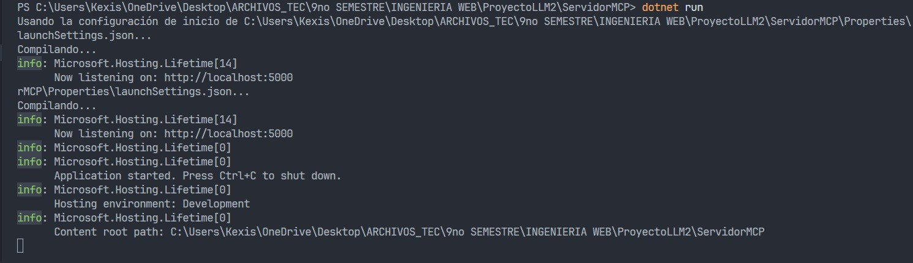
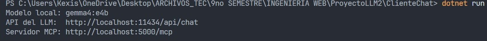
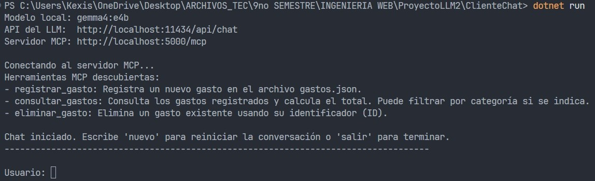
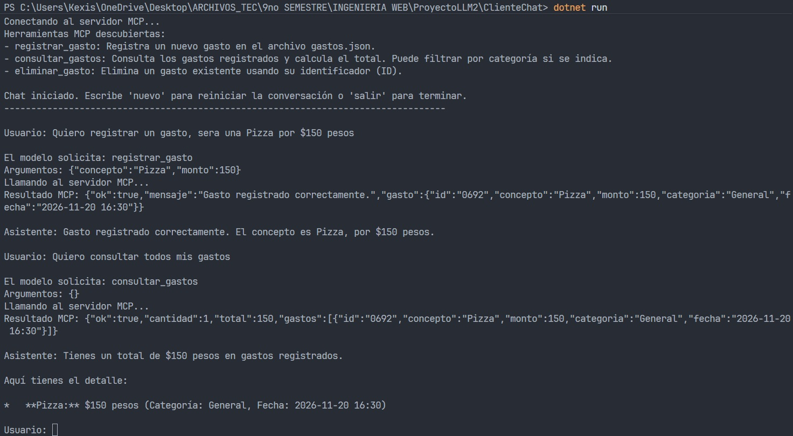
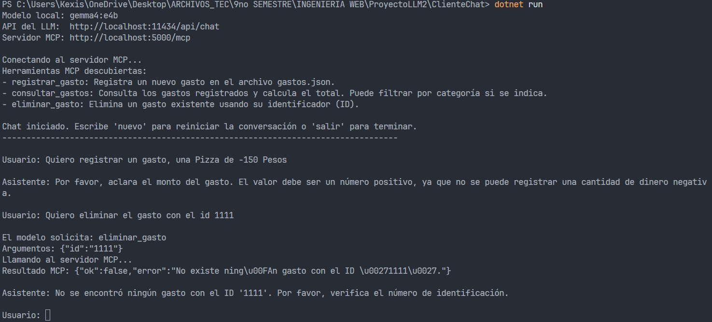

# Asistente de Control de Gastos con MCP y LLM Local 

## Nombre: Kevin Jasiel Sámano Machado

Aplicación de consola desarrollada en **C# (.NET)** que conecta un cliente de chat con un modelo de lenguaje local (**`gemma4:e4b`** en Ollama) y un servidor HTTP basado en **Model Context Protocol (MCP)** para registrar, consultar y eliminar gastos personales almacenados en `gastos.json`.

---

## Requisitos previos

- [.NET SDK 8.0 o superior](https://dotnet.microsoft.com/download)
- [Ollama](https://ollama.com/) instalado y en ejecución en el equipo.

---

## 1. Instalación y configuración del modelo en Ollama

1. Inicia la aplicación de **Ollama** en tu computadora (o ejecuta `ollama serve` en una terminal).
2. Descarga el modelo local utilizado en esta práctica ejecutando el siguiente comando:

```bash
ollama pull gemma4:e4b
```

3. Verifica que el modelo se haya descargado correctamente:

```bash
ollama list
```

---

## 2. Instalación de dependencias en cada carpeta

Abre una terminal en la carpeta raíz del proyecto y ejecuta los siguientes comandos para instalar los paquetes necesarios de **Model Context Protocol** en cada proyecto:

### En la carpeta `ServidorMCP`:
```bash
cd ServidorMCP
dotnet add package ModelContextProtocol.AspNetCore --prerelease
cd ..
```

### En la carpeta `ClienteChat`:
```bash
cd ClienteChat
dotnet add package ModelContextProtocol --prerelease
cd ..
```

---

## 3. Configuración

1. **Servidor MCP (`ServidorMCP/appsettings.json`):**
   Define la dirección HTTP donde escuchará el servidor (`http://localhost:5000`) y el nombre del archivo donde se guardan los datos (`gastos.json`).

2. **Cliente de Chat (`ClienteChat/config.json`):**
   Asegúrate de contar con el archivo `config.json` (basado en `config.example.json`) dentro de la carpeta `ClienteChat` con la siguiente estructura:

```json
{
  "mcp": {
    "url": "http://localhost:5000/mcp"
  },
  "llm": {
    "provider": "ollama",
    "baseUrl": "http://localhost:11434",
    "chatPath": "/api/chat",
    "model": "gemma4:e4b"
  }
}
```

---

## 4. Ejecución del proyecto

Para utilizar el sistema es necesario abrir **dos terminales** (manteniendo Ollama activo en segundo plano) y seguir este orden:

### Paso 1: Iniciar el servidor MCP
En la **primera terminal**, entra a la carpeta `ServidorMCP` y ejecuta el servidor:

```bash
cd ServidorMCP
dotnet run
```
*El servidor quedará escuchando en `http://localhost:5000`.*

### Paso 2: Iniciar el cliente de chat
En una **segunda terminal**, entra a la carpeta `ClienteChat` y ejecuta el cliente:

```bash
cd ClienteChat
dotnet run
```

- **Comandos disponibles dentro del chat:**
  - Escribe `nuevo` para limpiar el historial e iniciar una conversación nueva.
  - Escribe `salir` para cerrar la aplicación.

---

## 5. Evidencias de funcionamiento

### 1. Servidor MCP iniciado y accesible en su URL


### 2. Cliente mostrando configuración efectiva (modelo y URLs)


### 3. Descubrimiento de herramientas MCP


### 4. Conversación completa con llamada a herramienta MCP y respuesta final


### 5. Caso de validación o error controlado
